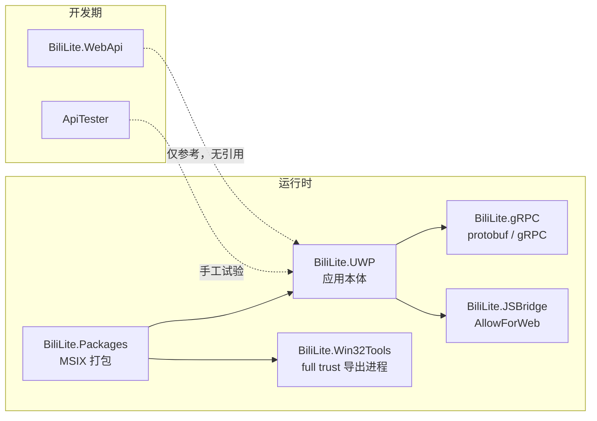

# 架构说明

BiliLite 是一个 C#/XAML 的 Windows 10/11 UWP 客户端（第三方哔哩哔哩客户端），解决方案 7 个项目。
本文说明分层、请求与播放的数据流、存储位置、外部依赖和扩展点。构建与调试步骤见
[DEVELOPMENT.md](DEVELOPMENT.md)；功能清单见 [FEATURES.md](FEATURES.md)。

## 1. 项目与依赖

| 项目 | 类型 / 目标 | 角色 | 依赖 |
| --- | --- | --- | --- |
| `src/BiliLite.UWP` | UWP（UAP 10.0.19041，最低 18362），`AssemblyName=BiliLiter` | 应用本体：启动、页面、控件、服务、解析层 | `BiliLite.gRPC`、`BiliLite.JSBridge`；FFmpegInteropX、SYEngine、WinUI 2（`Microsoft.UI.Xaml`）、Toolkit、WebView2、NSDanmaku、NLog、Newtonsoft.Json、RestSharp、OpenCCNET、ZXing |
| `src/BiliLite.Packages` | MSIX 打包项目（`wapproj`） | 唯一可安装产物 `BiliLite.Packages_<ver>_x64.msix`；清单、图标、`fullTrustProcess` 扩展 | `BiliLite.UWP`、`BiliLite.Win32Tools` |
| `src/BiliLite.gRPC` | `netstandard2.0` | protobuf 消息 + gRPC 传输（动态 v2、space、playurl、tv dm） | Google.Protobuf、Grpc、Grpc.Tools（构建期生成） |
| `src/BiliLite.JSBridge` | UWP 组件（`winmd`） | 只暴露 `[AllowForWeb] biliapp`：WebView 登录页回调 `ValidateLogin` / `CloseBrowser` | Microsoft.NETCore.UniversalWindowsPlatform |
| `src/BiliLite.Win32Tools` | .NET Framework 4.8 WPF | 完全信任伴随进程：解 `ffmpeg.7z`、视频导出/转码 | FFMpegCore、SharpCompress、Instances、System.Text.Json |
| `src/BiliLite.WebApi` | ASP.NET Core `netcoreapp3.0` | 与 App 无引用关系的旧辅助服务（EF Core SqlServer、Redis），不随包发布 | HtmlAgilityPack、EF Core、StackExchange.Redis |
| `src/ApiTester` | .NET Framework 4.8 WinForms | 签名/接口试验的临时工具，不随包发布 | 无（仅框架程序集） |



## 2. 应用内分层

| 目录 | 职责 | 关键文件 |
| --- | --- | --- |
| `Api/` | 请求构造：端点、参数、签名/鉴权。同步返回请求对象，不发请求 | `ApiHelper.cs`（基址、签名、appkey）、`User/WebDynamicFeedApi.cs`、`VideoAPI.cs`、`CommentApi.cs`、`SeasonApi.cs`、`Live/LiveRoomAPI.cs` |
| 传输 | HTTP / gRPC 传输，只回状态与正文，不解释业务字段 | `Helpers/HttpHelper.cs`（`HttpResults`：`status`/`code`/`results`/`Endpoint`/`RequestId`）、`Services/GrpcService.cs`、`BiliLite.gRPC/GrpcRequest.cs` |
| `Parsing/` | 拆信封 → 校验字段形状 → 映射到应用模型。不做网络、不发 toast | `Parsing/ApiEnvelope.cs`、`Parsing/ApiParseResult.cs`、`Parsing/Video/*`、`Parsing/Comment/*`、`Parsing/MediaList/*`、`Parsing/Season/*`、`Parsing/Dynamic/*` |
| `Models/` | 线上 DTO（`Models/Api/<Feature>/<Source>/`）与应用模型（`Models/Common`、`Models/Dynamic`、`Models/LocalMedia`） | `Models/Api/Video/`、`Models/Dynamic/`、`Models/CookieOrigins.cs` |
| `Modules/` | 视图模型：选来源、管分页与请求代次、发布行、决定用户提示 | `Home/DynamicVM.cs`、`Detail/VideoDetailVM.cs`、`Player/Playurl/*`、`DownloadVM.cs`、`SettingVM.cs` |
| `Pages/`, `Controls/`, `Dialogs/`, `Converters/` | 视图层。`Controls/PlayerControl.xaml` 是播放页宿主，`Controls/Dynamic/*` 是动态卡片，`Controls/CommentControl.xaml` 是评论区 | `MainPage.xaml`、`Pages/VideoDetailPage.xaml`、`Controls/PlayerControl.xaml` |
| `Services/` | 不依赖 XAML 树的服务与策略单元（可被离线探针直接编译断言） | `PlayerSessionState.cs`、`CookieService.cs`、`PlayerToastOverlay.cs`、`DynamicFeedWindow.cs`、`DynamicApiSelector.cs`、`MediaListService.cs` |
| `Helpers/` | 基础设施：日志、设置、HTTP、合并/映射辅助、剪贴板、版本检查 | `HttpHelper.cs`、`LogHelper.cs`、`SettingHelper.cs`、`MessageCenter.cs`、`Utils.cs`、`DynamicGrpcMapper.cs` |
| `Player/`、`Services/LocalMedia/` | 播放引擎封装与本地媒体库（清单校验、轨道解析、字幕/弹幕轨道） | `Controls/Player.xaml.cs`（FFmpeg/SYEngine 选择）、`LocalMediaValidator.cs`、`SubtitleTrackParser.cs` |

## 3. 一次请求的完整路径

以视频详情为例（`P4` 之后的形状，见 `plan/P4_INVENTORY.md`）：

```
VideoAPI.GetVideoInfo(aid/bvid)          // Api 层：构造 endpoint + 参数 + 签名
   ↓ HttpHelper.Get / Post               // 传输：HttpResults(status, code, results, Endpoint, RequestId)
   ↓ Parsing.ApiEnvelope.ReadResult      // 信封：选中 data/result，code 不等于 0 即失败
   ↓ Parsing.Video.WebVideoViewParser    // 字段表：形状校验、缺字段策略
   ↓ WebVideoViewMapper                  // 映射到应用模型（VideoInfo 等）
   ↓ Modules.Detail.VideoDetailVM        // 发布到绑定属性、决定 toast/兜底顺序
   ↓ Pages/VideoDetailPage + Controls    // 渲染
```

约定（与 `plan/PLAN.md` 第 4 项的命名契约一致）：请求构造器 `<Feature>Api`；解析入口
`Parse<Source><Payload>` 返回 `ApiParseResult<T>`；映射 `Map<Source><Payload>`；条件标量读取
`TryRead*`，失败与合法的 0/false 可区分；解析结果里有失败类别与上下文字段路径，便于定位。

来源选择与回退由服务/VM 决定，例如视频详情的 `web → 签名 app → 代理` 链、动态流的
`gRPC ⇄ legacy REST` 自适应（`Services/DynamicApiSelector.cs` + 持久化的
`dynamic-api-history.v1.json`）。

## 4. 播放链路

- `Controls/PlayerControl.xaml(.cs)`：一个播放页宿主，负责加载/切换清晰度、弹幕、播放目录、浮层提示、
  全屏与快捷键。
- `Controls/Player.xaml.cs`：媒体引擎层，三条开流路径（原生 DASH、FFmpegInteropX DASH、SYEngine 回退）。
- `Services/PlayerSessionState.cs`：每次打开/替换/关闭携带会话票据；未接受的会话里创建的资源在
  失效时释放，过期 continuation 与 `MediaOpened`/`MediaFailed` 被拒绝。
- `Controls/PlayDirectoryControl.xaml` + `Models/PlayDirectory.cs`（`PlayDirectoryBuilder`）：播放目录（分P/合集/播放列表/剧集正片/预告、
  搜索、定位正在播放、继续加载、连播）。
- `Services/PlayerSurfaceVisibility.cs`：按实际内容决定「弹幕列表 / 选集 / 节点 / 本地轨道」是否出现。
- `Services/PlayerToastService.cs` + `Controls/PlayerToast.xaml` + `Services/PlayerToastOverlay.cs`：
  音量/亮度/进度/倍速等浮层，key 复用，规则（文本格式、居中、偏移）与 XAML 分离以便探针断言。
- 进度：`Modules/…` 与本地续播记录按 `HistoryKey` 单一构造；播放中 30 s 检查点写入本地并静默上报一次历史。

## 5. 存储与本地状态

| 数据 | 位置 | 写入者 |
| --- | --- | --- |
| 设置（主题、播放、弹幕规则、下载、诊断开关等） | `ApplicationData.LocalSettings`，JSON 值 | `Helpers/SettingHelper.cs`（键集中在嵌套类） |
| 日志 | `LocalState/log/yyyyMMdd.log`（NLog，按会话 id 标记） | `Helpers/LogHelper.cs` |
| 响应形状采集 | `LocalState/log/api/yyyyMMdd.ndjson` + `baseline-<endpoint>.json` | `Services/ApiCapture.cs`、`Services/ApiShape.cs` |
| 诊断包 | 由页面把最近日志 + 采集打成 zip，内含 `manifest.json` | `Services/DiagnosticBundle.cs` + 设置页 |
| 动态来源历史 | `dynamic-api-history.v1.json`（`Services/DynamicApiHistoryFileStore.cs`） | `Services/DynamicApiSelector.cs` |
| 待确认的刷新事务 | 设置的键值（`Services/WebRefreshTransaction.cs`） | `Services/WebRefreshTransaction.cs` |
| Cookie | `Windows.Web.Http` 的 cookie jar，读写按 `Models/CookieOrigins.cs` 的域名表 | `Services/CookieService.cs`、`Services/CredentialCommitter.cs` |
| 下载/导出 | 用户选择的目录（`StorageApplicationPermissions` 令牌持久化） | `Modules/DownloadVM.cs`、`Helpers/DownloadHelper.cs`、`BiliLite.Win32Tools` |
| 本地媒体库 | 用户选择的文件夹 + 应用生成的清单（`Models/LocalMedia/`） | `Services/LocalMedia/*` |

## 6. 账号与凭证

- `CookieService`：cookie 读写、`SESSDATA`/`bili_jct`/`ac_time_value` 同步、单飞刷新、失效判定与
  重新登录事件。
- `CredentialCommitter`：一次提交的四个值快照 + 回滚 + 逐 cookie 记账，写入被拒也算失败。
- `RefreshCredentialPolicy` / `RefreshTokenPolicy`：refresh token 归属（哪个会话、哪种 appkey 取得）、
  `ac_time_value` 镜像、appkey 选择的纯函数单元。
- `WebRefreshTransaction`：correspond → refresh → confirm 的显式事务，带持久化的挂起记录，可续跑。
- `IsolatedPasswordLoginTransport` + `PasswordLoginSession`：密码登录在隔离 jar 里做，成功后一次性提交。
- `AccessKeyRenewal`：启动/恢复时的一次续期尝试，`Committed` 才算换了凭证。

## 7. 外部依赖

| 依赖 | 用途 | 备注 |
| --- | --- | --- |
| FFmpegInteropX（+ FFmpeg 包） | 无原生解码器时的软解 DASH | 播放回退路径 |
| SYEngine | 另一套 DASH 解码（x64/x86 支持，ARM64 无） | `App` 启动时按架构初始化 |
| NSDanmaku | 弹幕渲染 | 与直播弹幕完全独立 |
| Microsoft.UI.Xaml（WinUI 2）+ Toolkit | `TabView`、`Expander`、控件与动画 | `MainPage` 使用 WinUI `TabView` |
| WebView2 | 网页登录、Web 页 | 配套 `BiliLite.JSBridge` |
| NLog | 文件日志 | 每会话 id |
| Newtonsoft.Json | 全部 JSON（含 protobuf 之外的 body） | |
| RestSharp | 少量 API | 新增 API 优先用 `HttpHelper` |
| OpenCCNET / ZXing.Net | 繁简转换 / 二维码 | 用户名与扫码登录 |

## 8. 扩展点

- **加一个接口**：`Api/<Feature>` 构造请求 → `HttpHelper` 发送 → `Models/Api/<Feature>/<Source>` DTO →
  `Parsing/<Feature>` 解析/映射 → VM 发布。字段表写在解析器旁边，探针里加断言。
- **加一个设置项**：`SettingHelper` 的嵌套键类 + `SettingPage` 对应页签（十个页签的顺序见
  `plan/SETTINGS_PLAN.md`）；只写自己拥有的键。
- **加一个探针批次**：`plan/tests/<batch>/`（`net8.0` 控制台）用 `<Compile Include>` 链接真实产品源文件，
  `run.sh` 一行 `dotnet run --project …`；凡是能脱离 XAML 树的规则都应放在 `Services/` 或 `Parsing/`。
- **加一页**：`Pages/` 下 XAML + code-behind，`MessageCenter.NavigateToPageEvent` 负责导航与标签页；
  VM 放 `Modules/`，页面只做绑定与交互。
